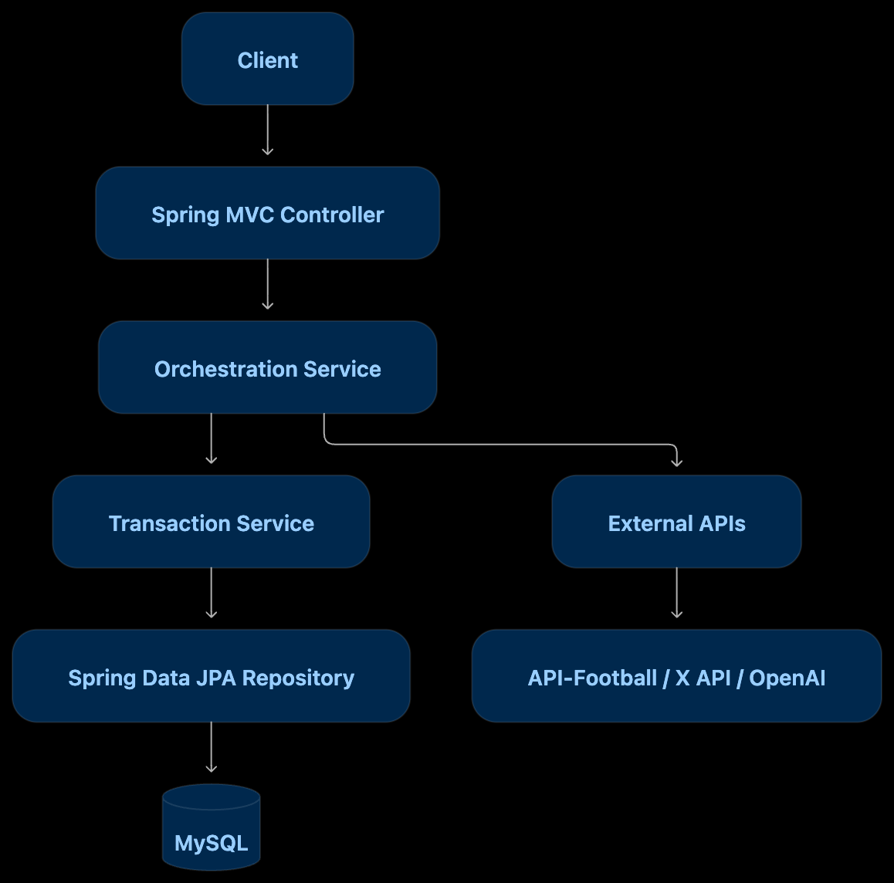

# TransferTracker

## 1. 프로젝트 소개

### 축구 정보를 수집하고 관리하는 서비스

TransferTracker 는 여러 외부 데이터 소스에 분산된 축구 관련 정보들을 수집하고, 선수 & 팀 정보들을 제공하는 서비스입니다.

- `API-Football` 을 활용해서 선수 & 팀 & 이적 데이터를 관리
- `X Api` 를 통해 축구 관련 정보들을 수집합니다.
- `Open AI Api` 를 통해서는, 외국어로 되어져있는 해외 게시물들을 한국유저들이 편하게 볼 수 있는, 한국어로 번역합니다.

## 2. 핵심 기능 

- 선수 & 팀 조회
- 이적 데이터 확인
- 외부 게시물 수집과 번역 

## 3. 기술 스택

| 분류 | 기술 |
|---|---|
| Language | Java 21 |
| Framework | Spring Boot 4.1.1 |
| Web | Spring MVC, RestClient |
| Security | Spring Security, JWT |
| Persistence | Spring Data JPA, Hibernate, QueryDSL |
| Database | MySQL 8.4 |
| Migration | Flyway |
| Infrastructure | Docker, Docker Compose |
| Testing | JUnit 5, Mockito, AssertJ, Testcontainers |
| External APIs | API-Football, X API, OpenAI API |

## 4. 시스템 전체 아키텍처

---

## 5. 프로젝트 구조 

## 6. 시작하기 

Git Clone
↓
환경변수 설정
↓
docker compose up -d
↓
MySQL 실행 확인
↓
Spring Boot 실행
↓
Flyway 마이그레이션
↓
API 정상 동작 확인

## 7. 테스트 

- JUnit 5 / Mockito / AssertJ / TestContainers

## 8. 기술적 의사결정 

## 9. 협업 / 기여 방법 

## 10. 관련 문서 

