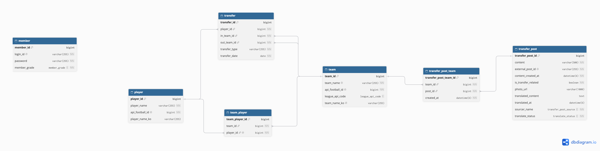

# TransferTracker

## 1. 프로젝트 소개

### 축구 정보를 수집하고 관리하는 서비스

TransferTracker 는 여러 외부 데이터 소스에 분산된 축구 관련 정보들을 수집하고, 선수 & 팀 정보들을 제공하는 서비스입니다.

- `API-Football` 을 활용해서 선수 & 팀 & 이적 데이터를 관리
- `X Api` 를 통해 축구 관련 정보들을 수집합니다.
- `Open AI Api` 를 통해서는, 외국어로 되어져있는 해외 게시물들을 한국유저들이 편하게 볼 수 있는, 한국어로 번역합니다.


## 2. 핵심 기능 

- 선수 & 팀 조회
- 이적 데이터 확인
- 외부 게시물 수집과 번역 

## 3. 기술 스택

| 분류 | 기술 |
|---|---|
| Language | Java 21 |
| Framework | Spring Boot 4.1.1 |
| Web | Spring MVC, RestClient |
| Security | Spring Security, JWT |
| Persistence | Spring Data JPA, Hibernate, QueryDSL |
| Database | MySQL 8.4 |
| Migration | Flyway |
| Infrastructure | Docker, Docker Compose |
| Testing | JUnit 5, Mockito, AssertJ, Testcontainers |
| External APIs | API-Football, X API, OpenAI API |

## 4. 시스템 전체 아키텍처


[상세 아키텍처 및 클래스 의존성](docs/architecture.md)

## Database ERD



자세한 도메인 설계는 [도메인 설계 문서](docs/domain-design.md)를 참고하세요.


## 5. 프로젝트 구조

TransferTracker는 도메인별로 패키지를 분리하고, 각 도메인 내부에서 조회(Query), 동기화(Sync), 명령(Command), 번역(Translation) 등의 기능을 구분하여 관리합니다.

```text
src/main/java/com/dhoon/transfertracker/
├── config/                  # Spring Security, JWT 등 공통 설정
└── internal/
    ├── member/              # 회원가입, 로그인 및 회원 인증
    ├── player/              # 선수 정보 조회, 동기화 및 이름 번역
    │   ├── query/
    │   ├── sync/
    │   └── translation/
    ├── team/                # 팀 정보 조회 및 동기화
    │   ├── query/
    │   └── sync/
    ├── teamplayer/          # 선수의 현재 소속팀 관리
    │   ├── query/
    │   └── sync/
    ├── transfer/            # 선수 이적 기록 조회 및 동기화
    │   ├── query/
    │   └── sync/
    └── transferpost/        # 외부 축구 게시물 수집, 조회 및 번역
        ├── command/
        ├── query/
        ├── sync/
        └── translation/
```

### 주요 계층의 역할

| 계층 | 역할 |
|---|---|
| Controller | HTTP 요청을 처리하고 응답 반환 |
| Orchestration Service | 외부 API 호출 및 여러 작업의 실행 흐름 조정 |
| Tx Service | 데이터베이스 작업과 트랜잭션 경계 관리 |
| Repository | JPA 기반 데이터 조회 및 저장 |
| Domain | 엔티티와 도메인 상태 및 규칙 관리 |

### 설계 방향

- **도메인 중심 구성:** 기능별 책임을 분리해 변경 범위를 명확하게 관리합니다.
- **작업 유형별 분리:** 조회, 동기화, 명령, 번역을 구분하여 각 기능의 역할을 명확히 합니다.
- **외부 API와 트랜잭션 분리:** 외부 API 호출 및 작업 흐름을 조정하는 계층과 데이터베이스 트랜잭션을 관리하는 계층을 분리합니다.
- **유지보수와 확장성 고려:** 새로운 외부 데이터 소스나 기능을 추가할 때 기존 코드에 미치는 영향을 줄이는 방향으로 설계합니다.

자세한 클래스 의존성 및 호출 구조는 [아키텍처 문서](docs/architecture.md)를 참고하세요.

## 6. 시작하기 (Getting Started)

### 실행 환경

- Java 21 / Spring Boot 4.1.1
- Docker / MySQL 8.4
- Gradle Wrapper

### 로컬 실행

**1. 프로젝트 클론**

```bash
git clone https://github.com/qlrxn1152/transfertracker-back-v1.git
cd transfertracker-back-v1
```

**2. 환경변수 설정**

MySQL 접속 정보, JWT Secret 및 외부 API 인증 정보를 설정합니다.

**3. MySQL 실행**

```bash
docker compose up -d
```

**4. Spring Boot 실행**

```bash
./gradlew bootRun --args='--spring.profiles.active=local'
```

애플리케이션 실행 시 Flyway를 통해 DB 마이그레이션을 적용합니다.

> 상세 환경변수 설정 및 실행 방법은 [로컬 개발 환경 가이드](docs/getting-started.md)를 참고하세요.

## 7. 테스트

JUnit 5, Mockito, AssertJ를 활용하여 비즈니스 로직을 검증합니다.

- **단위 테스트:** 외부 의존성을 Mock으로 격리하여 서비스 로직 검증
- **예외 검증:** 실패 시나리오 및 불필요한 후속 작업 방지 확인
- **통합 테스트:** Testcontainers 기반 MySQL 통합 테스트 도입 예정

**주요 테스트:** 회원가입 성공·중복 실패, 로그인 성공·비밀번호 불일치·회원 미존재

**실행 방법**

```bash
./gradlew test
```

[테스트 설계 및 검증 내용](docs/testing/testing.md)

## 8. 기술적 의사결정

주요 아키텍처 설계 및 기술 선택의 배경을 ADR로 기록합니다.

- [ADR-001: 외부 API 호출과 DB 트랜잭션 분리](docs/decisions/ADR-001-transaction-boundary.md)

