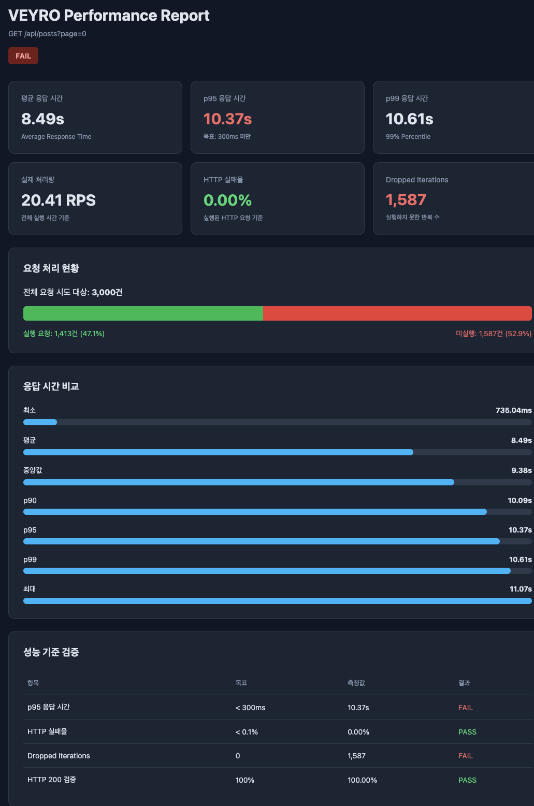
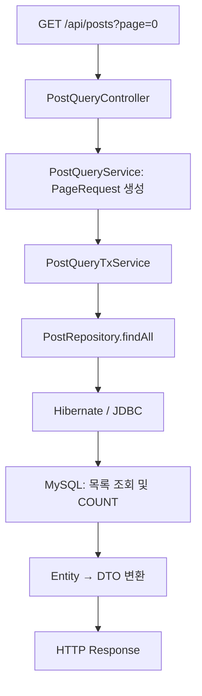
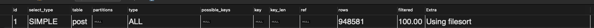
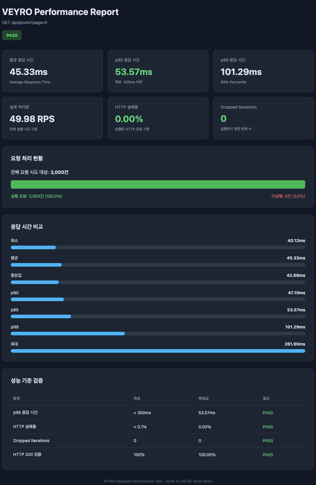

# 01. 게시물 최신순 조회 성능 최적화

> 게시물 100만 건의 최신순 조회 API에서 p95 응답 시간을 10.37초에서 53.57ms로 단축하고, 목표 50 RPS 부하 테스트 기준을 충족했다.

- **실험일:** 2026-11-24
- **대상:** `GET /api/posts?page=0`
- **변경:** `content_created_at` 단일 Secondary Index 추가
- **상태:** 인덱스 적용 및 Flyway V12 정상화 완료
- [트러블슈팅 목록](README.md)
- **기술 블로그:** [Velog — VEYRO 성능 개선기 #1: 게시물 100만 건 조회, p95 응답 시간 99% 단축](https://velog.io/@qlrxn115/VEYRO-%EC%84%B1%EB%8A%A5-%EA%B0%9C%EC%84%A0%EA%B8%B0-1-%EA%B2%8C%EC%8B%9C%EB%AC%BC-100%EB%A7%8C%EA%B1%B4-%EC%A1%B0%ED%9A%8C-MySQL-%EC%9D%B8%EB%8D%B1%EC%8A%A4%EB%A5%BC-%ED%86%B5%ED%95%B4-p95-%EC%9D%91%EB%8B%B5-%EC%8B%9C%EA%B0%84-99-%EB%8B%A8%EC%B6%95)

## 1. 개선 결과 요약

| 지표 | 개선 전 | 개선 후 | 변화 |
|---|---:|---:|---:|
| 목록 조회 SQL 실행 시간 | 340ms | 0.583ms | 약 583분의 1 |
| 평균 HTTP 응답 시간 | 8,490ms | 45.33ms | 99.47% 감소 |
| p95 HTTP 응답 시간 | 10,370ms | 53.57ms | **99.48% 감소** |
| p99 HTTP 응답 시간 | 10,610ms | 101.29ms | 99.05% 감소 |
| 실제 처리량 | 20.41 RPS | 49.98 RPS | 약 2.45배 |
| 실행 요청 수 | 1,413 | 3,000 | 약 2.12배 |
| Dropped Iterations | 1,587 | 0 | 100% 감소 |
| HTTP 실패율 | 0% | 0% | 유지 |

위 수치는 로컬 Performance 환경에서 확보한 개별 측정 결과이며, 운영 환경의 최대 처리량을 의미하지 않는다. SQL 실행 시간은 `EXPLAIN ANALYZE` 단건 측정값이며, HTTP 응답 시간과 별개의 지표이다.

## 2. Problem — 문제 상황

VEYRO의 게시물 목록 API는 작성 시간 기준 최신 게시물을 페이지당 30건씩 반환한다. 소량의 데이터로 기능을 검증하는 것만으로는 대규모 데이터에서의 조회 성능을 확인하기 어려워, 게시물 100만 건을 적재하고 목표 50 RPS 부하 테스트를 진행했다.



실행된 HTTP 요청은 모두 성공했지만, 3,000개 반복 중 1,587개가 실행되지 못했다. 응답 시간이 길어 가용 VU가 부족해졌으며, HTTP 실패율 0%만으로는 목표 부하를 처리했다고 판단할 수 없었다.

초기에는 커넥션 풀 부족을 의심해 HikariCP 최대 크기를 10에서 50으로 변경하는 실험을 진행했다. 그러나 목표 성능에 도달하지 못해 SQL 실행 비용을 먼저 분석하기로 했다.

### 실험 환경

| 항목 | 설정 |
|---|---|
| Java | 21 |
| Application | Spring Boot, Spring Data JPA, Hibernate |
| DB | MySQL 8.4 / InnoDB / Docker |
| DB 주소 | localhost:3308/veyro_performance |
| Application 포트 | 8081 |
| Profile | performance |
| 게시물 수 | 1,000,000건 |
| HikariCP | 최대 50 (Performance 설정 기준) |
| k6 Executor | constant-arrival-rate |
| 목표 요청률 / 기간 | 50 iterations/s / 60초 |
| VU | preAllocated 50 / max 200 |
| 성능 기준 | p95 < 300ms, HTTP 실패율 < 0.1%, checks 100%, dropped 0 |

한 반복에서 HTTP 요청을 한 번 전송한다. 실제 RPS는 보고서의 전체 실행 시간 기준이며, 측정 시 종료 대기 시간이 포함될 수 있다.

## 3. API 실행 흐름

아래 코드는 [최적화 전 기준 커밋 `c7fe168`](https://github.com/qlrxn1152/transfertracker-back-v1/commit/c7fe1687a46ac7da921bec835b2da43b3e6e3105)에서 확인한 관련 메서드를 발췌한 것이다.

### Controller

```java
@GetMapping("/api/posts")
public ResponseEntity<PostsResponseDto> getPosts(
        @RequestParam(defaultValue = "0") int page) {
    PostsResponseDto response = postQueryService.getPosts(page);
    return ResponseEntity.ok(response);
}
```

### Service

```java
public PostsResponseDto getPosts(int page) {
    validatePageNotNegative(page);
    Pageable pageable = createPostPage(page);
    Page<Post> postPage = queryTxService.getPosts(pageable);

    List<PostItemResponseDto> posts = postPage.getContent()
            .stream()
            .map(PostItemResponseDto::createPost)
            .toList();

    return PostsResponseDto.of(posts, postPage.getTotalElements(),
            postPage.getTotalPages(), postPage.hasNext(), postPage.hasPrevious());
}

private Pageable createPostPage(int page) {
    return PageRequest.of(
            page,
            30,
            Sort.by(Sort.Order.desc("contentCreatedAt"), Sort.Order.desc("id"))
    );
}
```

작성 시간이 동일한 게시물의 정렬 순서도 일관되도록 PK를 두 번째 정렬 조건으로 사용한다.

### TxService / Repository

```java
public Page<Post> getPosts(Pageable pageable) {
    return postRepository.findAll(pageable);
}
```

`PostRepository`는 `JpaRepository<Post, Long>`을 상속한다. `PostQueryService`에는 클래스 레벨 `@Transactional(readOnly = true)`, `PostQueryTxService`에는 `@Transactional`이 선언되어 있다. 기본 `REQUIRED` 전파에서는 내부 서비스가 외부 트랜잭션에 참여한다.



첫 페이지가 가득 찬 이 실험에서는 목록 조회와 전체 건수 조회가 수행된다. Hibernate SQL을 의미상 단순화하면 다음과 같다.

```sql
SELECT * FROM post
ORDER BY content_created_at DESC, post_id DESC
LIMIT 30;

SELECT COUNT(*) FROM post;
```

`Page`가 모든 상황에서 COUNT를 실행하는 것은 아니다. 일부 페이지에서는 반환된 데이터 수로 전체 건수를 추론할 수 있다.

## 4. Cause — 실행계획 분석

### COUNT 쿼리

```sql
EXPLAIN ANALYZE SELECT COUNT(*) FROM post;
```

```text
-> Count rows in post  (actual time=59..59 rows=1 loops=1)
```

단건 측정 결과는 59ms였다. 목록 조회보다 상대적으로 빠르므로 목록 조회를 우선 개선했다. COUNT의 인덱스 접근 방식은 이 출력만으로 확정하지 않으며, 인덱스 적용 후 별도로 재측정할 필요가 있다.

### 목록 조회 쿼리

```sql
EXPLAIN SELECT * FROM post
ORDER BY content_created_at DESC, post_id DESC LIMIT 30;
```



| 항목 | 값 |
|---|---|
| type | ALL |
| key | NULL |
| rows | 948,581 (추정치) |
| Extra | Using filesort |

```sql
EXPLAIN ANALYZE SELECT * FROM post
ORDER BY content_created_at DESC, post_id DESC LIMIT 30;
```

```text
-> Limit: 30 row(s)  (cost=116771 rows=30) (actual time=340..340 rows=30 loops=1)
    -> Sort: post.content_created_at DESC, post.post_id DESC, limit input to 30 row(s) per chunk  (cost=116771 rows=948581) (actual time=340..340 rows=30 loops=1)
        -> Table scan on post  (cost=116771 rows=948581) (actual time=0.0433..277 rows=1e+6 loops=1)
```

정렬 조건을 충족하는 인덱스가 없어 100만 건 전체를 탐색하고 Filesort로 최신 30건을 선별했다. `LIMIT`이 있어도 전체 탐색을 피하지 못했다. 다만 MySQL의 LIMIT 정렬 최적화 때문에 100만 건 전체를 완전히 정렬했다고 단정할 수는 없다. Filesort 역시 반드시 디스크 정렬을 의미하는 것은 아니다.

Table Scan 반복자의 마지막 행 반환 시점은 277ms, 최상위 Limit 반복자의 완료 시점은 340ms였다. 반복자 시간은 중첩되므로 각 시간을 합산하지 않는다.

부하 상황에서는 이러한 쿼리가 반복 실행되면서 DB 자원 경쟁과 커넥션 점유 증가를 유발할 가능성이 있다. 정확한 커넥션 대기 시간은 별도 메트릭으로 검증해야 한다.

## 5. Solution — 단일 인덱스 선택

다음 두 가지 인덱스를 고려했다. 실제 적용한 것은 A이다.

```sql
-- A: 단일 인덱스 (선택)
CREATE INDEX idx_post_content_created_at ON post(content_created_at);

-- B: 명시적 복합 인덱스 (비교 후보, 적용하지 않음)
CREATE INDEX idx_post_content_created_at_id ON post(content_created_at, post_id);
```

InnoDB Secondary Index에는 PK가 함께 저장된다. `post_id`가 PK인 현재 테이블에서는 `content_created_at`의 단일 인덱스가 내부적으로 작성 시간과 PK 순서를 갖는다. MySQL 옵티마이저는 Index Extension을 이용해 이 PK를 정렬 최적화에 사용할 수 있다.

```text
Secondary Index (ASC, 개념 예시)
content_created_at       post_id
2026-01-01 10:00:00      1
2026-01-02 10:00:00      4
2026-01-02 10:00:00      7
2026-01-03 10:00:00      10

역방향 탐색: 10 → 7 → 4 → 1
```

`ORDER BY content_created_at DESC, post_id DESC`는 두 컬럼 모두 내림차순이므로 역방향 탐색으로 충족할 수 있다. `SELECT *`는 인덱스에 없는 컬럼이 필요하므로 PK를 이용한 Clustered Index Lookup이 필요하지만, 첫 페이지에서 필요한 행만 반환하도록 탐색을 조기에 종료할 수 있다.

명시적인 복합 인덱스가 반드시 더 큰 저장 공간을 사용하는 것은 아니다. 이 사례의 선택 근거는 PK가 이미 포함되어 있고 실행계획상 단일 인덱스로 정렬 조건을 충족한다는 점이다. 복합 인덱스와 별도의 성능 비교 실험을 진행한 것은 아니다.


## 6. Verification — 실행계획 재검증

동일한 목록 조회 SQL을 다시 실행했다.

```text
-> Limit: 30 row(s)  (cost=0.735 rows=30) (actual time=0.517..0.583 rows=30 loops=1)
    -> Index scan on post using idx_post_content_created_at (reverse)  (cost=0.735 rows=30) (actual time=0.379..0.443 rows=30 loops=1)
```

| 항목 | Before | After |
|---|---|---|
| 접근 방식 | Table Scan | Backward Index Scan |
| 스캔 반복자 반환 행 수 | 1,000,000 | 30 |
| 별도 Sort 반복자 | 존재 | 없음 |
| 최상위 반복자 실행 시간 | 340ms | 0.583ms |

`reverse`는 역방향 인덱스 탐색을 나타낸다. 30은 스캔 반복자가 반환한 행 수이며, 물리적 페이지 접근이나 내부 B+Tree 탐색 횟수를 뜻하지 않는다.

### API 부하 테스트 결과



p95 53.57ms, 실제 처리량 49.98 RPS, Dropped Iterations 0건으로 모든 설정 기준을 충족했다. 상세 비교 수치는 문서 상단의 표를 참고한다.

## 7. 스키마 변경 관리

`Post` 엔티티의 기존 인덱스 선언에 다음 항목을 추가했다.

```java
@Index(name = "idx_post_content_created_at", columnList = "content_created_at")
```

Flyway V12에도 다음 SQL을 반영했다.

```sql
CREATE INDEX idx_post_content_created_at
    ON post (content_created_at);
```

`ddl-auto=validate`는 인덱스를 자동 생성하는 설정이 아니므로 실제 스키마 변경은 Flyway로 관리한다. V12 초기 실행 실패 후 Performance DB의 인덱스 상태와 실패 이력을 정리하고 마이그레이션을 정상화했다. 이미 성공한 마이그레이션은 임의 수정하지 않는다.

## 8. 재현 방법

> 모든 실험은 폐기 가능한 Performance 전용 DB에서만 수행한다. Local/Production DB에서 인덱스 삭제, 더미 데이터 적재 또는 마이그레이션 이력 수정을 하지 않는다.

1. 프로젝트 루트에서 `docker compose -f performance/docker-compose.yml up -d` 실행.
2. 최적화 전 기준 코드와 V11까지 적용된 별도 실험 DB를 준비한다. 이미 V12가 적용된 DB를 임의로 되돌리지 않는다.
3. 빈 실험 DB에 `performance/seed/seed-posts.sql`, `performance/seed/seed-posts-extend.sql`을 순서대로 한 번만 실행한다. `SELECT COUNT(*) FROM veyro_performance.post;`로 100만 건을 확인한다.
4. Performance 프로파일로 애플리케이션을 실행하고, SQL 확인 후 DEBUG/TRACE 로깅을 끈다. 외부 연동 작업을 중지하고 DB/JVM 설정 및 워밍업 조건을 기록한다.
5. `EXPLAIN` 및 `EXPLAIN ANALYZE`를 실행하여 결과를 저장한다. k6 실행과 동시에 진행하지 않는다.
6. 프로젝트 루트에서 아래 명령으로 부하 테스트를 실행하고 보고서를 보존한다.

```bash
mkdir -p performance/results
k6 run performance/scripts/posts-list.js
cp performance/results/posts-report.html performance/results/01-post-index-before.html
```

Threshold 실패로 k6 종료 코드가 0이 아니더라도 보고서가 생성될 수 있다. 보고서가 이번 실행에서 새로 생성되었는지 확인한다.

7. 인덱스 생성 마이그레이션 적용 후 동일한 데이터, 애플리케이션 코드, 커넥션 풀, 로깅 및 부하 조건으로 재측정한다. 보고서는 `02-post-index-after.html` 등 별도 이름으로 보존한다.

```bash
k6 run performance/scripts/posts-list.js
cp performance/results/posts-report.html performance/results/02-post-index-after.html
```

8. 실행계획과 API 지표를 비교한다. 재현성을 높이려면 각 조건을 여러 차례 반복하고 분산까지 기록한다.

## 9. 한계 및 트레이드오프

- 이 문서는 확보된 단건 SQL 실행계획과 대표 부하 테스트 결과를 기록한다. 반복 측정 결과, 워밍업 조건, 전후 로깅 설정의 동일성 및 실제 실행 커밋은 추가 확인이 필요하다. 따라서 수치를 인덱스만의 엄밀한 인과 효과나 운영 성능 보장으로 해석하지 않는다.
- Secondary Index는 저장 공간과 INSERT/UPDATE/DELETE 시 유지 비용을 추가한다. 쓰기 부하에 대한 영향은 별도 측정하지 않았다.
- 첫 페이지의 최신순 조회가 대상이다. 깊은 OFFSET 페이지, 기자별 조회, COUNT 비용 및 최대 처리량은 별도 실험이 필요하다.

## 10. Lessons Learned

- 커넥션 풀 확장에 앞서 SQL 실행 비용을 확인할 필요가 있다.
- `LIMIT`은 반환 건수를 제한하지만, 인덱스가 없다면 탐색 비용까지 제한하지 못할 수 있다.
- 정렬 컬럼 수만으로 복합 인덱스 필요 여부를 결정하지 않고 스토리지 엔진의 인덱스 구조와 실행계획으로 검증해야 한다.
- SQL 단건 실행 시간과 API 부하 테스트 결과는 구분하고, HTTP 실패율과 Dropped Iterations를 함께 확인해야 한다.

**다음 과제:** 인덱스 적용 후 COUNT 쿼리의 비용을 재측정하고, 전체 건수 및 페이지 수가 서비스에 필요한지 확인한 뒤 `Page`와 `Slice`의 변경 가능성을 검토한다.

## 참고 자료

- [MySQL 8.4 — ORDER BY Optimization](https://dev.mysql.com/doc/refman/8.4/en/order-by-optimization.html)
- [MySQL 8.4 — Use of Index Extensions](https://dev.mysql.com/doc/refman/8.4/en/index-extensions.html)
- [MySQL 8.4 — LIMIT Query Optimization](https://dev.mysql.com/doc/refman/8.4/en/limit-optimization.html)
- [MySQL 8.4 — EXPLAIN Output Format](https://dev.mysql.com/doc/refman/8.4/en/explain-output.html)
- [k6 — Constant arrival rate](https://grafana.com/docs/k6/latest/using-k6/scenarios/executors/constant-arrival-rate/)

